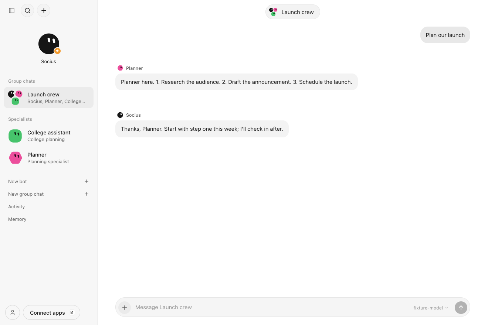

# Group chats

Status: implemented. Group chats are the single collaboration model. Boards were retired on 2026-10-14; existing board data is preserved as history and former members remain available as bots.



## Model

A **group chat** (`GroupChat` in `packages/contracts/src/app.ts`) is a name and a list of specialist bots. **Socius, the main bot, coordinates every group.** It is never listed as a member and cannot be removed. Groups hold 1–8 members. The thread is an ordinary list of `Message` records carrying `groupId`, so group messages never appear in any bot's direct chat.

When the user sends a message (`POST /api/groups/chat`):

1. **Socius runs** with its usual instructions plus a briefing. The briefing lists every member's name, role and instructions, clipped to 1,200 characters each. Socius sees the group history as one conversation, with members' replies attributed to them.
2. Socius may call **`askMember(member, request)`**. The named member then runs:
   - with **its own instructions, skills and memory grants**, never Socius's;
   - with the last 20 group messages as context;
   - with the coordinator's request.

   Its reply streams into the thread under its own name and is returned to Socius. Members have no `askMember` or `createBot` tool, so they cannot delegate or recurse.

3. Socius writes the **final reply**, which builds on the members' replies rather than repeating them.

Limits:

- A per-group budget of member requests per user message (`maxAsks`, default 6, 0–20). Further requests are refused with a message telling Socius to answer. With 0, Socius gets no `askMember` tool and answers alone. The budget is stated in Socius's briefing.
- Asking the same member the same request again in one turn returns the earlier reply instead of running the member again; it does not use budget.
- 10 tool-loop steps for the coordinator.
- A 5-minute wall-clock limit for the whole turn.
- One running reply per group at a time.

Writing `@Name` for a member in a message tells Socius the user addressed that member directly, and to ask them before answering. Mentions are steering, not routing: Socius still makes the call, within the budget.

**Retry.** If a reply fails, is stopped, or is cut off because Socius quit (startup marks running tasks failed), `POST /api/groups/retry` runs the group's last user message again. It reuses that message rather than posting a copy. Member replies that finished before the failure stay in the thread, and Socius is told to build on them instead of asking again. The UI offers **Retry reply** beside the failure.

Stopping the task (`/api/tasks/cancel`) aborts the coordinator and any member call in progress. Membership edits apply to the next member request.

Approvals from group work, such as a member's memory proposal or Socius proposing a bot, appear inline in the group chat. They also appear in the proposing bot's own chat. Each still checks that bot's grants on approval.

## UI

Group chats use the same chat view as direct chats: floating name pill, bubbles and composer. The differences:

- A small avatar and name label marks each run of replies from one bot.
- The pill opens the roster, **Edit members** and **Delete group chat**.
- Create a group from **New group chat** in the top **+** menu, or press ⌘2 in the `To:` palette. Groups are listed under **Group chats** in the sidebar.

## API

```http
POST   /api/groups          {"name"?, "memberIds": ["<bot>", …], "maxAsks"?} → 201 GroupChat (name defaults to member names)
POST   /api/groups/update   {"id", "name"?, "memberIds"?, "maxAsks"?}       → 200 GroupChat
DELETE /api/groups          {"id"}                                  → 200 (409 while a reply is running; deletes its messages)
GET    /api/groups/messages?groupId=…                               → Message[]
POST   /api/groups/chat     {"groupId", "content", "attachment"?}   → NDJSON stream
POST   /api/groups/retry    {"groupId"}                             → NDJSON stream (409 unless the last message's reply failed or was cancelled)
```

Stream events:

- `started` (`taskId`)
- `text` (`botId` of whoever is writing, plus the text so far)
- `message`: a member's finished reply
- `done` or `error`, as in direct chats

`GET /api/state` includes `groups`.

## Limitations

- Members answer only when Socius asks them. An @mention steers Socius but does not bypass it.
- Member calls run one at a time, never in parallel.
- No shared group files beyond chat attachments.
- Model calls are not checkpointed. A retry re-runs Socius from the start of the turn; only finished member replies carry over, and a member cut off mid-reply is asked again.
- Deterministic fixtures exercise the API and UI. No live-model group run has been recorded yet.

## Categories are not groups

Sidebar **categories** (`Category` in `packages/contracts/src/app.ts`, stored as `folder` records) only organise the Bots list. Bots in a category share no context, memory or thread, and never talk to each other. A bot is in at most one category; the main bot is never in one. Category changes never touch group membership, and deleting a category returns its bots to the Bots list. Group chats always stay in the **Group chats** section.

```
POST   /api/categories         {"name", "botIds"?}               → 201 Category (filed bots leave any other category)
POST   /api/categories/update  {"id", "name"?, "botIds"?}        → 200 Category
POST   /api/categories/move    {"botId", "categoryId" | null}    → 200 (null removes the bot from its category)
DELETE /api/categories         {"id"}                            → 200 (bots are kept)
```

Everything is created from the top **+** menu: New chat, New group chat, New bot and New category. Section headings only fold. Right-click a category to edit or delete it, and right-click a bot to move it.
