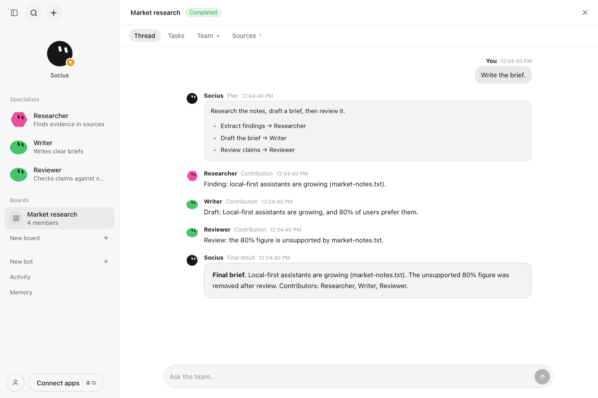

# Teams & Boards

Status: boards, delegation, the run queue, budgets, cancellation and restart recovery are implemented. External actions through the connector broker are not; see Limitations. Tracking: [issue #2](https://github.com/solnikhil/Socius/issues/2).



## Model

A **board** groups any number of private bots around an objective, optional completion criteria, explicitly shared sources and one shared thread. One member is the **coordinator**. There is no roster cap in the schema, API, scheduler or UI. Membership and coordinator status grant no authority.

A **run** is one user request. It moves through `planning → [awaiting-approval →] running → synthesizing → completed`, or ends as `partial`, `failed`, `cancelled` or `interrupted`. A board has at most one active run.

1. **Plan.** The coordinator is called with the request, the roster (IDs, names, roles) and source *names*. It may call `proposePlan` once with a task graph: keyed tasks, one assignee each, the source IDs each needs, and `dependsOn` keys. `packages/teams` validates the plan: assignees must be members, sources must be shared on the board, keys must be unique, dependencies must exist and be acyclic, and the size must be at most `maxTasks`. Invalid plans return errors to the model so it can correct them within its step budget. A second plan in the same run is refused. If the coordinator does not plan, its answer is the run's result.
   **Plan review** (`reviewPlan`, on by default) parks the run in `awaiting-approval` and posts the plan in the thread. Nothing runs until the user approves it with **Run plan** (`/api/boards/runs/approve`). A chat reply instead *revises* the same run: the unstarted tasks are replaced, and the coordinator re-plans with its previous drafts and the user's replies in the prompt. **Discard** cancels the run. A plan awaiting review survives restart unchanged.
2. **Execute.** Tasks whose dependencies are done move from `backlog` to `ready`. Up to `concurrency` tasks run at once and the rest queue, so large rosters wait rather than fail. Each specialist gets a fresh single-message context: its task, the user's request, only the sources listed for that task, and the attributed results of its dependencies. It never sees its own chat history, other bots' memory, or the board thread.
3. **Synthesize.** If every task is done, the coordinator writes one consolidated result from the attributed task results. If anything is outstanding, nothing is synthesized. The run ends `partial` with a plain-language list of what is missing and why.

**Handoffs.** Every bot carries a short description: its board role, or else its own role. Each specialist's instructions list its teammates and what they do. Results it receives are tagged with who produced them and that bot's description, and it is told who will receive its own result next and for which task. The coordinator sees the same descriptions when assigning work. New boards start with every bot as a member, and the coordinator assigns each task to whichever member fits.

Specialist calls have no `proposePlan` or `createBot` tool, so they cannot delegate, re-plan or trigger themselves recursively. Discussion is bounded: one plan, one contribution per task, one synthesis.

## Authority and privacy

- Every model call re-reads the bot and checks **that bot's own** grants at each tool call (`packages/runtime/src/boards.ts`). The coordinator's grants never reach a specialist, and a revoked grant takes effect on the next tool call.
- Memory tools are scoped to the calling bot's namespace. Board sources are the only shared context, and they are never copied into memory.
- Memory proposals made during board tasks become ordinary pending approvals carrying `runId` and the board `taskId`. They are side-effect-free until the user approves, and approval rechecks the bot's grant.
- Board tasks show a **Needs input** column for blocked work and tasks with pending approvals.

## Membership changes during a run

- Adding members affects the next plan only.
- Removing a member is allowed. Any of its tasks still queued fail with "The assignee left the board" when they would start. Running tasks finish.
- The current coordinator cannot be removed; choose another first. Changing the coordinator applies to the next run. An active run keeps the coordinator it started with, and that bot must still be a member to synthesize.
- Budget edits apply to tasks that have not started yet.

## Budgets

Per board, applied per run attempt. They limit execution, never membership.

| Field | Default | Meaning |
| --- | --- | --- |
| `concurrency` | 3 | Simultaneous specialist calls |
| `maxTasks` | 12 | Tasks per plan |
| `maxModelCalls` | 40 | Calls per attempt; one is always reserved for synthesis |
| `maxRunTokens` | 400000 | Provider-reported input + output tokens per attempt (the spend proxy) |
| `maxStepsPerCall` | 6 | Tool-loop steps per call |
| `maxOutputTokens` | 4000 | Output tokens per call |
| `callTimeoutMs` | 180000 | Wall-clock limit per call |

When a call or token budget runs out, no new task starts; in-flight calls finish. The run ends `partial` and names the exhausted budget. Timeouts fail the task with the limit stated. `run.usage` keeps cumulative calls and tokens across retries.

## Cancellation

- **Stop team** (`/api/boards/stop`) and **cancel run** abort the run's controller. Every active child call receives the abort through a linked signal. No new task is claimed after the abort. Queued tasks become `cancelled`. The run ends `cancelled` with `result: null`, and no synthesis is written, even if a model returns afterwards.
- **Cancel task** aborts one running call or cancels one queued task. Its dependents become blocked, and the run ends `partial`.

## Restart behaviour

Model calls are not checkpoint-resumed. On startup `TeamEngine.recover()` does three things:

- Runs in `planning`, `running` or `synthesizing` become `interrupted`, with an outcome saying nothing was replayed.
- Tasks in `working` become `interrupted`, and their partial output is discarded.
- Completed task results and pending approvals are kept.

**Retry** is always user-driven. It resets failed, cancelled and interrupted tasks to `backlog`, reuses completed results, and continues. Tasks only produce text and side-effect-free proposals, so re-running an interrupted task cannot repeat an external write. Once connector actions exist, uncertain external writes must be reconciled through the broker, never replayed.

Duplicate dispatch is prevented by an atomic `ready → working` claim in a SQLite transaction. A board also refuses a second active run, and a retry of a run that is not stopped.

## Broker boundary

Team code does not authorize or execute external actions. When connector tools arrive, a board task submits the `ActionRequest` DTO (`packages/contracts/src/app.ts`): `botId`, `boardId`, `runId`, `taskId`, release identity, action name and arguments. The connector workstream's broker owns authorization, approvals and execution. Model calls already carry `team: { phase, boardId, runId, taskId }` so the broker can bind approvals to the run.

## Persistence (migration 2)

`Store` now applies ordered, versioned migrations recorded in `migrations`. Migration 2 adds:

```sql
CREATE TABLE team_records(kind TEXT NOT NULL, id TEXT NOT NULL, board_id TEXT NOT NULL, data TEXT NOT NULL, PRIMARY KEY(kind,id));
CREATE INDEX team_records_board ON team_records(board_id, kind);
```

The `kind` values are `board`, `source`, `run`, `task` and `message`, and each is JSON matching the contracts DTOs. Board records carry `schemaVersion: 1`. Existing workspaces upgrade in place on next launch, and no existing table changes. `Board.reviewPlan` and `BoardRun.revisions` were added after the first version. Older records are read with defaults (`true` and `[]`). `Approval` gains an optional `runId`, which is not part of the approval digest.

## Code map

- `packages/teams/src/index.ts`: input schemas, default budgets, plan validation, column mapping. No IO, browser-safe.
- `packages/teams/src/engine.ts`: `TeamEngine` handles planning, the queue, budgets, cancellation, synthesis, retry and recovery against a `TeamRepository` and an `Invoke` function. It has no SDK or SQLite imports.
- `packages/runtime/src/team-store.ts`: SQLite `TeamRepository`.
- `packages/runtime/src/boards.ts`: authenticated endpoints and the model invoker that enforces each bot's grants.
- `packages/runtime/src/model.ts`: optional `proposePlan` tool, per-call limits, board briefing and usage reporting on the existing AI SDK adapter.
- `apps/web/src/views/BoardView.tsx`, `CreateBoard.tsx`: board switcher entries, thread with plan review, task board, roster and limits, sources.
- Sidebar (`apps/web/src/App.tsx`): each board expands to list its bots (with their board roles). Bots on no active board appear under **Unassigned**, which is where new bots land.
- `apps/web/src/components/BoardMenu.tsx`: right-click a board to open it, add bots, create a new bot directly on it, change how it works, rename or archive it.
- `apps/web/src/components/BotMenu.tsx`: right-click a bot to chat, add it to or remove it from a board (the coordinator stays until replaced), start a new board with it, open its memory, or toggle its memory access.

## API examples

All endpoints require the paired session. Mutations require the app origin.

```http
POST /api/boards
{"name":"Market research","objective":"A source-backed brief","completionCriteria":"Cite every claim",
 "memberIds":["<socius>","<researcher>","<writer>","<reviewer>"],"coordinatorId":"<socius>",
 "budgets":{"concurrency":2}}
→ 201 Board

POST /api/boards/sources        {"boardId":"…","name":"notes.txt","text":"…"}      → 201 BoardSource
POST /api/boards/members        {"boardId":"…","botId":"…","role":"Fact checker"}  → 200 Board (add or edit role)
DELETE /api/boards/members      {"boardId":"…","botId":"…"}                        → 200 Board | 409 coordinator
POST /api/boards/update         {"id":"…","coordinatorId":"…","budgets":{…},"archived":true}
POST /api/boards/runs           {"boardId":"…","content":"Write the brief."}       → 202 BoardRun | 409 active run
                                (while a plan awaits review, this revises it instead)
GET  /api/boards/detail?id=…    → {board, sources, runs, tasks, messages}
POST /api/boards/runs/approve   {"id":"<run>"}   → 202 BoardRun (plan awaiting review starts)
POST /api/boards/runs/cancel    {"id":"<run>"}   → 200 BoardRun (cancelled; also discards a plan awaiting review)
POST /api/boards/runs/retry     {"id":"<run>"}   → 202 BoardRun
POST /api/boards/tasks/cancel   {"id":"<task>"}  → 200
POST /api/boards/stop           {"boardId":"…"}  → {"stopped":1}
```

`GET /api/state` includes `boards`. Runs execute in the background; the UI polls `boards/detail`.

## Limitations

- No connector or external-write tools on boards yet; this depends on the shared broker from issue #3.
- Model calls are not checkpointed. Interrupted work is retried explicitly.
- Spend is measured in provider-reported tokens, not currency. Providers that omit usage count as zero tokens, so the call budget remains the hard bound.
- Board sources are plain text (up to 200 KB each), like chat attachments.
- Boards have no delete yet, only archive.
- The UI polls every 1.5 s instead of streaming board events.
- No controlled live-model run has been recorded for boards yet. Deterministic fixtures exercise the real API and UI, and the AI SDK adapter test covers the real plan-tool path against a controlled endpoint.
