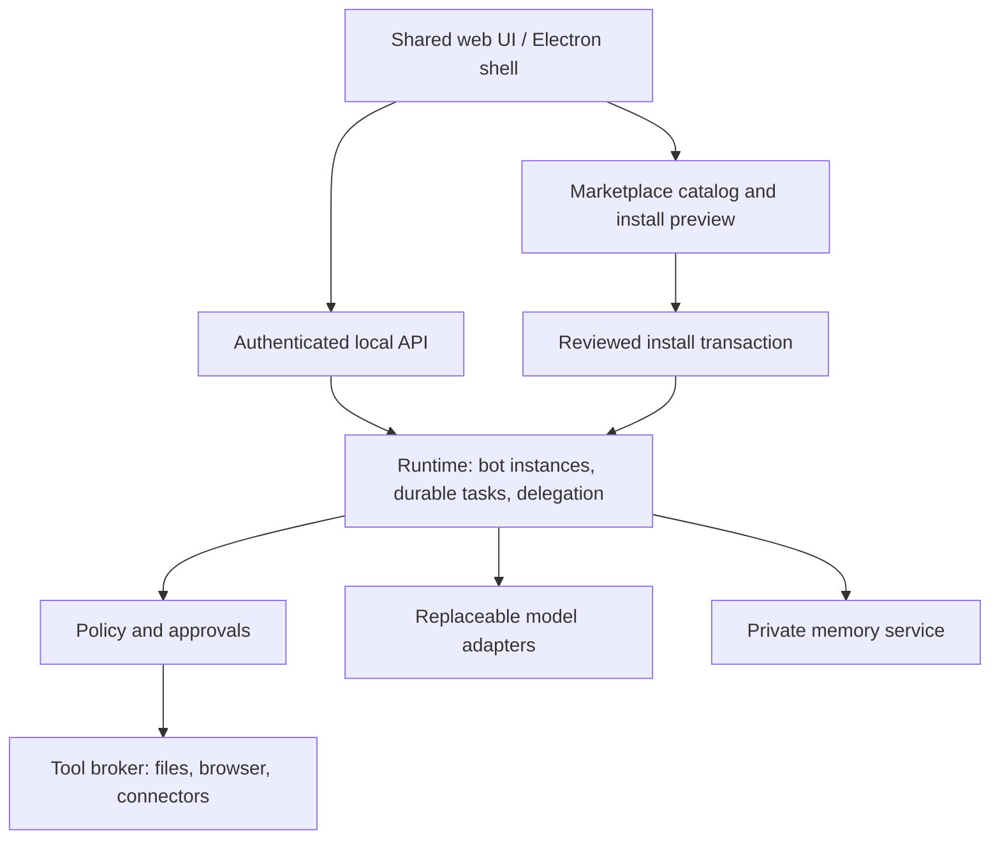

# V1: main bot and marketplace

Status: runnable Electron application and local AI SDK runtime implemented. See README for supported flows and remaining integrations.

## Product model

The user starts with **Socius**, the master orchestrator. It is a bundled bot template (`mainBot` in `packages/marketplace/src/index.ts`) instantiated into private user state. For each request it picks the lightest path: answer itself, point to an existing specialist, suggest a group chat (where it coordinates members with `askMember`), or propose a new specialist with `createBot`, preferably adapted from a bot template. Its prompts do not grant authority: every tool action must pass through the runtime policy service.

In its direct chat, Socius receives a live roster each turn: specialist names, roles and categories, group chats and their members, and the bot templates it can adapt. It cannot message other bots from its direct chat; delegation happens in group chats. Socius's instructions are not user-editable, so when `mainBot.version` changes the runtime replaces the stored instructions and role on start.

Two marketplace tabs share one catalog:

1. **Skills & Connectors**: filter by instruction-only skills or MCP connector definitions.
2. **Bots**: installable role templates that reference reusable skills/connectors.

A skill describes how to do work. A connector supplies authenticated tools/data. A bot defines responsibility, instructions and required dependencies. A routine binds a private bot instance to a schedule or event. A routine is disabled until enabled by its owner.

**Group chats** are the collaboration model: Socius coordinates specialists in one shared conversation and asks members for help as needed ([Group chats](group-chats.md)). Each bot keeps its own model, memory, skills and connector permissions. Boards were retired on 2026-10-14; their existing database records are retained, but there is no board UI, API or execution engine. All specialist bots remain usable.

## Boundaries

Frontend and transport remain independent of the runtime. Tailscale provides private remote routing; application authentication, pairing and authorization remain ours. Cloud providers receive selected context; local-first must not be described as automatically offline. Local jobs pause when the host sleeps.

The updated Notion stack supersedes earlier proposals: use Markdown memory files with SQLite FTS5, and electron-builder/electron-updater for desktop packaging. Supermemory is no longer the baseline. The user selected AI SDK for the initial runtime; Mastra/Eve evaluation is no longer a release prerequisite. Evaluation must demonstrate Ollama/direct-cloud compatibility, restart recovery, cancellation, durable approvals and bypass prevention. Model adapters must advertise supported capabilities rather than assume all models can use tools. See [implementation sequence](implementation-sequence.md).

## Manifest contract implemented now

Schema v1 supports `skill`, `connector`, and `bot`. IDs use `publisher/name`; versions and dependencies are exact stable `major.minor.patch` values. Unknown fields, duplicate capabilities and duplicate dependency IDs are rejected. Templates intentionally have no private-memory, transcript, credential or permission-grant fields. Free-text fields can still contain sensitive information: schema validation is not a secret detector or publication review.

Catalog installation planning detects missing dependencies, cycles and conflicting versions, returns dependencies first, and aggregates requested capabilities without granting them. Instantiation creates a fresh bot ID and memory namespace with no grants and disabled routines. No content is executed during these operations.

## Installation lifecycle

1. Fetch publisher metadata and immutable release identity.
2. Resolve the exact dependency graph and runtime compatibility.
3. Show source, capabilities, dependency list and setup needs.
4. Verify release digest and publisher trust under the registry's signing policy.
5. Ask for installation and scoped permission consent; bind it to that exact release.
6. Stage package files safely (reject path traversal/symlink escapes), then atomically commit installation records.
7. Authenticate connectors through secure handoff and credential storage.
8. Create private bot state with routines disabled.
9. Record a redacted activity event. Support uninstall, rollback and permission revocation.

Steps 1–9 are implemented for curated, registry-reviewed and locally imported releases; publisher signatures are not ([details](skills-and-connectors.md)). Updates that expand requested permissions require fresh consent. Publishing starts from an allowlist of template fields, excludes private state, and requires human review of text/content. Never serialize a running bot into a public package.

## Remaining runtime work

- SQLite migrations for instances, installation receipts, permission grants, tasks, approvals and audit events; framework workflow storage may remain separate with documented references and recovery.
- Durable task states: queued, running, awaiting approval/user, completed, failed, cancelled. Approvals bind exact action parameters, user, expiration and release identity.
- Shared policy gate for scheduled jobs, delegation and browser actions. MCP connector actions already use the action broker. Fail closed if authorization is absent; revalidate before side effects.
- Per-bot/tool budgets and cancellation propagation; concurrency ownership for shared browser sessions/files.
- Executable plugin isolation with enforced filesystem/network scopes. A spawned process is not sufficient isolation.
- Source-backed memory correction/deletion and explicit sharing scopes; artifact tracking and human login takeover.

## Deferred decisions

The updated Notion document defers a plugin sandbox beyond V1. Consequently V1 must not execute arbitrary marketplace code: instruction-only skills, reviewed first-party integrations and explicitly trusted MCP services are the initial boundary. Trusted local MCP processes can access host resources; they must not be represented as sandboxed. Marketplace hosting/auth/signatures, public SDK compilation, initial connector packages, desktop signing, and project license are open. No paid marketplace, arbitrary plugin execution or always-on cloud host is implemented by this foundation.
