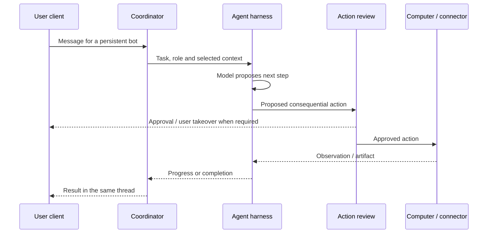

# Grok Bot: product behavior and local architecture

Research date: 2026-10-14. Installed macOS app examined: 0.70.2. These findings describe the accessible product documentation and a read-only package inspection, not a reconstruction of the private server implementation. No app sessions, keychain entries, authentication tokens or personal bot state were accessed. No proprietary code is copied into Socius.

## 1. Local installation versus execution

The desktop app is a control surface. Official documentation says bots use one persistent **cloud computer per user**, sharing files, browser sessions and logins. Isolation is at the user boundary rather than between individual bots. Jobs continue after the laptop closes; desktop and phone reach the same working environment. The product also provides an action-review facility and enterprise network controls. These are vendor descriptions, not independently audited guarantees.

This distinguishes three systems: the client the user installs, the agent execution service, and the computer where tools operate. The official website does not establish that all inference or tools execute locally. Local-computer capabilities can coexist with a cloud-first product.

Source: [official overview and FAQ](https://x.ai/bot).

**Socius implication:** separate UI, agent runtime and tool host. V1 executes on the user's laptop and honestly pauses while it sleeps. Optional cloud execution can implement the same contracts later.

## 2. What makes a bot useful

The launch description presents persistent agents that carry context across tasks, remember corrections, and coordinate work. Specialists can exchange messages and participate in shared threads; a coordinator can delegate work instead of making the user relay every result. Demonstrated workflows involve multiple steps across applications and return completed work into those applications. Teaching a workflow captures behavior for reuse; it is not evidence that the model weights are retrained.

Source: [official launch description](https://x.ai/news/introducing-grok-bot).

**Socius implication:** bot identity should survive an individual conversation. Keep role configuration, private memory and task records separately. Delegation needs explicit parent/child ownership, context scopes, limits and cancellation. A bot's appearance is independent of its permissions and model choice.

## 3. Tools, triggers and approvals

The official 101 guide describes a bot through name, title and description. It can receive work from chat, routines/events and other bots. It supports MCP, plugins and skills used by Cursor, with multiple connected accounts. Users can take over the remote computer for CAPTCHA/2FA and enter credentials through secure forms.

The guide describes natural-language rules with a separate reviewer that allows, blocks or escalates proposed actions. It acknowledges reliance on model interpretation of those rules. Shared logins mean another bot can reach an already-authenticated service.

Source: [Grok Bot 101](https://x.ai/bot/guides/grok-bot-101).

**Socius implication:** retain the approachable instructions, but enforce authority in code at the tool broker. A reviewer can add judgment without being the only boundary. Credentials stay outside prompts; login handoff is first-class. A shared browser profile needs ownership/locking, and access to a session must not automatically grant every bot permission to use it.

## 4. Marketplace and template lifecycle

Official templates package reusable instructions, selected memory/context, skills and supported plugins. Sharing begins privately, with team/public publication as a further step. Recipients inspect included context and integrations, then create a distinct bot. Some integrations require reinstallation/setup; non-standard MCP servers and custom code are not automatically included. The documentation describes exclusion of personal/internal information; that should not be assumed to be an infallible sanitizer.

Source: [Templates for Grok Bot](https://x.ai/bot/guides/templates-for-grok-bot).

The public marketplace offers category browsing, creator/name search and bot detail/add flows. Entries explain the role, prerequisites and approval boundaries. It is evidence of the discovery surface, not proof of internal ranking, package signing or payment implementation.

Source: [official marketplace](https://x.ai/bot/marketplace).

**Socius implication:** publish reusable configuration through an explicit allowlist. Never export live bot state by default. Surface dependencies and permissions before install, and create a fresh instance. Separate catalog releases from installed versions and private instances. Add digest verification, trust policy and review as our own requirements.

## 5. The main bot pattern

An official work guide uses several narrow assistants reporting through a coordinating bot. The coordinator consolidates updates and routes user questions to the appropriate specialist. This is a user workflow demonstrated by the vendor, not proof of a particular internal orchestration algorithm.

Source: [Grok Bot for Work](https://x.ai/bot/guides/grok-bot-for-work).

**Socius implication:** ship Socius as the default personal coordinator. Users can ask it to perform ordinary tasks directly and add specialist templates as needed. It uses the same runtime as marketplace bots. Keep updates consolidated and do not create an agent for every trivial action. The main bot must not receive a blanket permission bypass.

## 6. What the installed app reveals directly

Reproduce with `python3 scripts/inspect-grok-bundle.py`. The script reads bundle metadata, the ASAR directory and package metadata only.

Observed on this machine:

| Observation | Interpretation and limit |
| --- | --- |
| Bundle ID `com.anysphere.sand`; package `sand`; version `0.70.2` | Internal identifiers for this installed build; branding may differ |
| `dist/electron-main/main.cjs` and Electron preload files | Packaged Electron main/preload architecture |
| `react`, `react-dom` | React included in the application dependencies |
| `dist/node-agent-coordinator/main.cjs` | A separately packaged coordinator exists; exact runtime responsibilities unverified |
| `dist/local-exec-daemon/main.cjs` | A local execution component exists; does not establish that every bot runs locally |
| `preload-vnc.cjs` | Remote-desktop integration is represented in the client; transport guarantees unverified |
| ConnectRPC, Protobuf and `ws` dependencies | RPC/message/network tooling included; exact backend topology unverified |
| MCP, store-sync, summarization and harness package names | Named integration boundaries present; algorithms and storage semantics not established by names |

These observations support a modular client/runtime/tool architecture. File names and dependencies alone cannot establish approval correctness, memory extraction, model routing, task scheduling or whether a feature is active for this account.

## 7. How a task likely moves through the system

The following is an architectural inference from the product behavior and package boundaries, not a traced request:

Skills supply procedure, connectors supply tools, and routines supply activation. Memory and transcript context influence the next model call. Multi-bot work adds routing and shared-resource coordination to that loop. Exact retrieval, compaction, retry, review coverage and scheduling internals remain unknown.

## 8. What remains unknown and what to test next

- Memory schema, conflict resolution, retention/deletion semantics and extraction model.
- Full coordinator protocol, queue topology, crash recovery and idempotency semantics.
- Cloud-computer provisioning, isolation mechanism and per-bot concurrency/desktop locking.
- Coverage of action review across browser, terminal and connector calls.
- Skill activation/ranking, prompt compilation and marketplace integrity checks.
- Local-computer attach lifecycle and its exact relationship to the cloud host.

A controlled follow-up should use a disposable account/workspace and synthetic data: create a bot; install a template; inspect its setup; test a benign connector task; pause/resume; test approval of an exact draft; teach a workflow; restart the client; and inspect visible run records. The scope performed here is metadata inspection and public documentation research. No server access, authenticated probing or end-to-end Grok Bot run was performed.

Do not use third-party installer repositories merely because they call themselves official. An examined repository (`grok-bot-app/grok-bot`) explicitly calls itself an unofficial guide despite its branding. Community shims may be informative experiments, but they do not establish supported interfaces or belong in our production dependencies.
